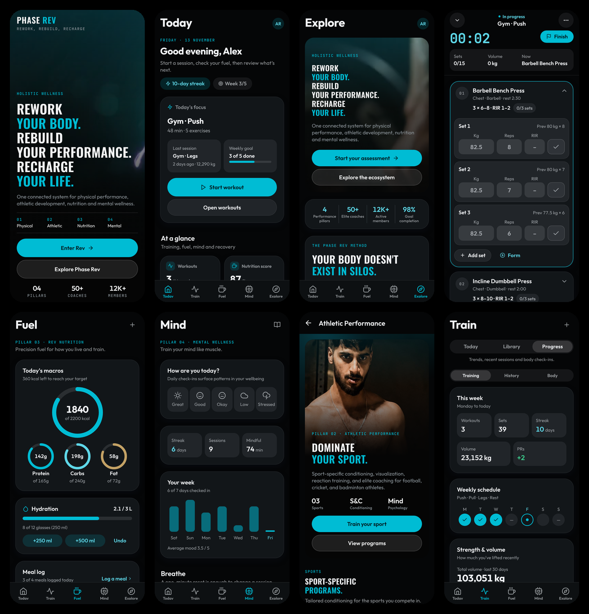

# Phase Rev — Mobile App (Expo · React Native · JavaScript)

The app for **Phase Rev** — _Rework, rebuild, recharge._
One connected system for **physical performance, athletic development, nutrition and mental wellness**.

This is the mobile version of the whole website at
[`phaser2023/PHASEREV`](https://github.com/phaser2023/PHASEREV): the public story (ecosystem,
four pillars, coaches, membership, assessment) **and** the member area (Rev). It uses the same
brand, copy, colours, coach assets, demo account and data shapes, so the website and the app
feel like one product.



<sub>Android / web rendering. On iOS 26+ the tab bar, headers, cards and buttons are Liquid Glass.</sub>

- **Expo SDK 58** · React Native 0.88 (New Architecture) · React 19.3 · **Expo Router**
- **Plain JavaScript only** — no `.ts` / `.tsx`. Data shapes are JSDoc in
  [`src/types/models.js`](src/types/models.js).
- **Zustand + AsyncStorage** — everything survives restarts, even a workout in progress.
- **iOS 26 Liquid Glass** with a native tab bar, native large-title headers, SF Symbols, native
  segmented controls, sheets, alerts and action sheets. Android gets a clean Material-leaning
  version of the same design.
- Runs in **Expo Go** — every native module used ships with Expo Go.

---

## Quick start

```bash
npm install
npm start            # then press i (iOS), a (Android) or scan the QR code with Expo Go
npm run web          # optional: run it in the browser
```

**Demo account** (same as the website): `demo@phaserev.com` / `demo1234`
— or tap **"Use demo account"** on the login screen. Not signed in? **Explore Phase Rev** on the
welcome screen opens the public side of the app (pillars, coaches, membership, assessment).

> **Seeing Liquid Glass:** run on an **iOS 26+** simulator or device (Xcode 26). On iOS 18 and
> earlier the app automatically falls back to blurred system headers and a solid tab bar.

| Script                   | What it does                                                     |
| ------------------------ | ---------------------------------------------------------------- |
| `npm start`              | Expo dev server                                                  |
| `npm test`               | Unit tests + screen smoke tests (Jest, iOS preset)               |
| `npm run test:android`   | The screen smoke tests again with the Android preset             |
| `npm run lint`           | ESLint (Expo rules + import/alias checks)                        |
| `npm run format`         | Prettier over `src/`                                             |
| `npm run export:ios`     | Production bundle check (Hermes) without a device               |
| `npm run export:android` | Same for Android                                                 |

---

## How the app is organised

Five tabs, each with its own native stack (large titles on iOS):

| Tab         | What's in it                                                                                                    | Website equivalent                 |
| ----------- | --------------------------------------------------------------------------------------------------------------- | ---------------------------------- |
| **Today**   | Today's focus, start/resume workout, at-a-glance tiles (workouts, nutrition score, mind streak, **recovery**), week rhythm, fuel, mood, activity, wins | `/rev/overview`                    |
| **Train**   | **Today** (plan with last time vs aim for) · **Library** (exercises, favourites, routines, skills, sport programs) · **Progress** (volume, e1RM, muscle balance, heatmap, PRs, insights, history, body + progress photos) | `/rev/workouts`, `/physical-performance` |
| **Fuel**    | Macro rings, hydration, meal log (tick to log, quick add, remove), **interactive regional globe** (14 regions), meal plans, live weekly calories, nutrition expert | `/rev-nutrition`                   |
| **Mind**    | Mood check-in, streak & mindful minutes, mood week, breathing, guided sessions, journal, thought reframe, wellbeing check | `/mental-wellness`                 |
| **Explore** | The website's story in the app: hero video, method, four pillars, "one system", ecosystem dimensions, coaches, membership, community, stories, final CTA | `/` homepage, `/ecosystem`         |

Screens reachable from the tabs:

| Screen                         | What the member can do                                                                     | Website equivalent              |
| ------------------------------ | ------------------------------------------------------------------------------------------ | ------------------------------- |
| **Pillar pages** (×4)          | Hero, programs/paths, features, included list, CTA — each links to the working tool in the app | `/physical-performance`, `/athletic-performance`, `/rev-nutrition`, `/mental-wellness` |
| **Ecosystem**                  | Four pillars, how they connect, dimensions explorer                                        | `/ecosystem`                    |
| **Coaches** + coach profile    | Specialties, filters, roster with real photos & flyers, approach, credentials              | `/coaches`                      |
| **Book a consultation**        | Pick format (1:1 live / remote / group), preferred time, note → saved request              | coach / nutrition expert CTAs   |
| **Membership**                 | Essential / Performance / Elite, comparison table, 7-day trial                             | `/pricing`                      |
| **Assessment**                 | 4-step baseline (BMI, goal, activity) → recommended path, saved to profile                | homepage `#assessment`          |
| **Active workout**             | Log weight · reps · RIR (or hold seconds), rest timer (±, pause, skip), PR feedback        | active mode                     |
| **Session complete**           | Duration, sets, volume, PRs, streak → history                                              | SessionComplete                 |
| **Breathing / guided sessions**| Reset breath, box breathing, wind-down; Deep Focus, Pre-game focus, Visualization, Evening wind-down | mental wellness sessions        |
| **Reaction drill**             | 5-trial reaction test with history                                                         | athletic "reaction training"    |
| **Journal**, **Thought reframe**, **Wellbeing check** | Guided prompt sets, 5-step CBT-style thought record, 5-question check with trend | mental wellness practices       |
| **Profile**                    | Identity, baseline, membership & coaching requests, appearance, haptics, rest timer step, reset demo, sign out | —                               |

---

## iOS 26 — what "native" means here

| Piece                | iOS 26+                                                          | iOS 18 and earlier / Android / web           |
| -------------------- | ---------------------------------------------------------------- | -------------------------------------------- |
| Tab bar              | System tab bar (`NativeTabs`), minimises on scroll, live workout shown as the **tab bar accessory** (like Music's mini player) | JS tab bar + floating "Resume workout" pill |
| Headers              | Native large titles, transparent glass bar, SF Symbol buttons, prominent "Save"/"Sign in" items | Blurred material (iOS < 26) · Material header (Android) |
| Cards, buttons, chips| `GlassView` (regular / clear / tinted) — off when *Reduce Transparency* is on | Solid surfaces with hairline borders         |
| Icons                | SF Symbols (`expo-symbols`), mapped in `components/ui/icon-map.json` | Feather                                      |
| Segmented controls   | `UISegmentedControl`                                             | Capsule control                              |
| Confirmations        | `UIAlertController` alerts + action sheets                       | Native alert (Android) · drawn dialog (web)  |
| Modals               | Page sheets, form sheets with detents and grabber                | Modal stack                                  |
| Type                 | SF Pro (body), SF Rounded (numbers & timers), SF Mono (eyebrows), Oswald (brand headlines) | Outfit, JetBrains Mono, Oswald               |

All of this is decided in one place: `src/lib/platform.js` (`LIQUID_GLASS`) +
`ThemeProvider` (`theme.glass`). Components never check the OS version themselves.

---

## Folder guide (where to look)

```
phaserev-app/
├── app.json                 Expo config (name, icons, splash, plugins, permissions)
├── jsconfig.json            "@/…" → src/…  and  "@assets/…" → assets/…
├── assets/                  Brand icons, coach portraits & flyers, pillar art, hero video
├── docs/ARCHITECTURE.md     ← read this to understand how everything connects
└── src/
    ├── app/                 ROUTES ONLY — every file is a screen (Expo Router)
    │   ├── (auth)/          welcome, login (guests)
    │   ├── (tabs)/          (home) (train) (fuel) (mind) (explore) — one stack per tab
    │   └── …                pillar/[id], ecosystem, coaches/*, membership, assessment,
    │                        workout/*, session/[id], breathing, reaction, journal/*, …
    ├── components/
    │   ├── ui/              Screen, Surface (glass), Card, Button, ListSection/ListRow,
    │   │                    SegmentedControl, Dialog, TextField, Carousel, Icon…
    │   ├── charts/          LineChart, BarChart, ProgressRing, Heatmap (SVG, no chart lib)
    │   ├── brand/           Wordmark, BrandHeadline, MediaCard, HeroVideo
    │   └── navigation/      TabStack (per-tab native stack)
    ├── features/            Domain code, one folder per area
    │   ├── workouts/  nutrition/  mental/  athletic/  assessment/
    │   ├── pillars/  explore/  coaches/  membership/
    │   └── home/  auth/  profile/
    ├── stores/              Zustand stores (session, profile, training, preferences)
    ├── services/            The only code that talks HTTP (api-client, auth-service)
    ├── hooks/               useMember, useProfile, useMemberLink, useDayRollover, …
    ├── constants/           All copy + catalog + seed data (ported from the website)
    ├── theme/               Palette → light/dark tokens, type scale, spacing
    ├── providers/           ThemeProvider (useTheme), AppProviders
    ├── lib/                 platform, dates, formatting, haptics, header items, photo storage
    └── types/models.js      JSDoc data models
```

**The one rule:** `app/` (screens) → `features/` (domain UI + logic) → `components/` (generic UI)
→ `theme/`. Imports only ever point _down_ that list.

---

## Brand system (from the website)

| Token            | Value                          | Where it comes from                     |
| ---------------- | ------------------------------ | --------------------------------------- |
| Brand black      | `#050505` (app canvas `#050607`) | `globals.css` `--bg-primary`          |
| Deep teal        | `#085F70`                      | `globals.css` `--accent-primary`        |
| Champagne        | `#C4A265`                      | `globals.css` `--accent-champagne`      |
| Rev cyan (dark)  | `#00BCD4`                      | `rev-app.css` dark `--rev-accent`, "REV" in the wordmark |
| Rev cyan (light) | `#0097B2`                      | `rev-app.css` `--rev-accent` (darkened for contrast) |
| Fonts            | **Oswald** (wordmark, headlines) everywhere; **Outfit** + **JetBrains Mono** on Android/web; SF Pro / Rounded / Mono on iOS | `layout.tsx` |
| Radius           | 26 cards · 16 tiles · pill buttons (continuous corners on iOS) | `rev-app.css` |

See [`src/theme/palette.js`](src/theme/palette.js) and [`src/theme/themes.js`](src/theme/themes.js).

---

## Connecting a real backend

The app runs in **demo mode** until you set an API URL:

```bash
# .env  (see .env.example)
EXPO_PUBLIC_API_URL=https://api.phaserev.com/v1
```

`services/auth-service.js` then calls `POST /auth/login` instead of checking the demo account,
and `services/api-client.js` attaches the bearer token. The endpoints match the website's
`FRONTEND_BACKEND_INTEGRATION.md`. Details in [docs/ARCHITECTURE.md → Backend](docs/ARCHITECTURE.md#7-connecting-the-backend).

---

## Building for the stores

```bash
npx eas-cli@latest build --platform ios       # or android
```

Bundle IDs are `com.phaserev.app` (change in `app.json`). `ios/` and `android/` are generated
(Continuous Native Generation) — don't create them by hand. Build with **Xcode 26** so the iOS
build picks up Liquid Glass.

See [CHANGELOG.md](CHANGELOG.md) for what changed in 1.1.0.
