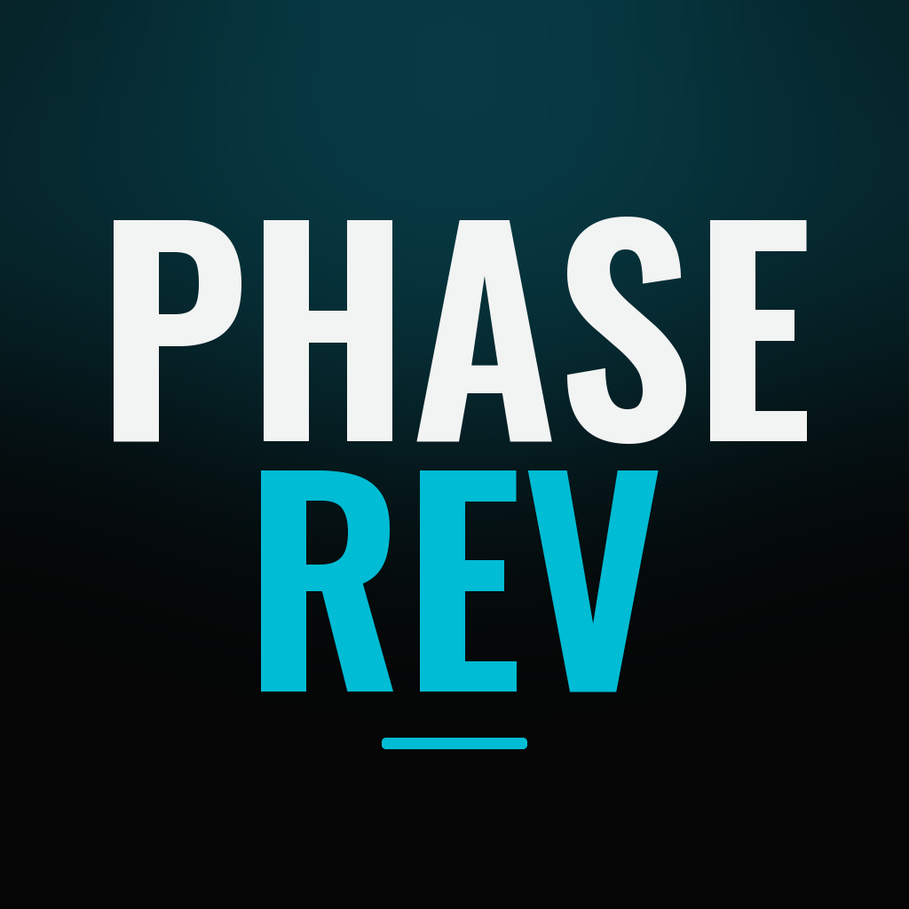
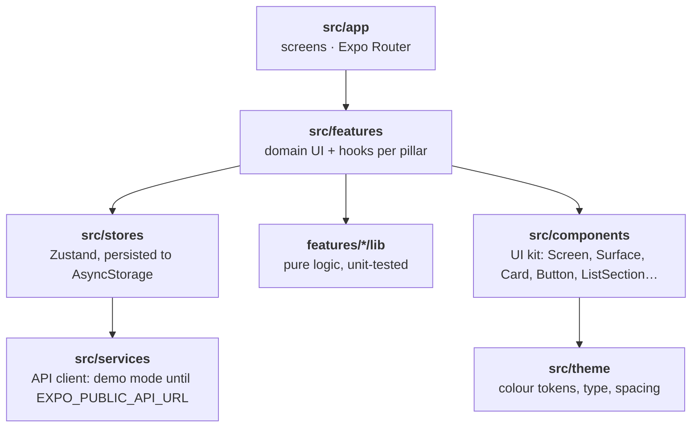

<div align="center">



# Phase Rev

**Rework your body. Rebuild your performance. Recharge your life.**

The mobile app for Phase Rev: one connected system for physical performance,<br />
athletic development, nutrition and mental wellness, on iOS and Android.

[](https://docs.expo.dev)
[](https://reactnative.dev)
[](#native-on-ios-26)
[](#native-on-ios-26)
[](#conventions)

<br />


<sub>Android rendering shown. On iOS 26+ the navigation bar, tab bar and every control are Liquid Glass.</sub>

</div>

---

**Contents:** [Highlights](#highlights) ·
[What's inside](#whats-inside) ·
[Native on iOS 26](#native-on-ios-26) ·
[Getting started](#getting-started) ·
[Architecture](#architecture) ·
[Design system](#design-system) ·
[Quality](#quality) ·
[Backend](#connecting-a-backend) ·
[Releasing](#building-for-the-stores) ·
[Roadmap](#roadmap)

## Highlights

- **The whole Phase Rev website, in your pocket.** The story, the four pillars, the ecosystem,
  coaches, membership and the assessment from
  [`phaser2023/PHASEREV`](https://github.com/phaser2023/PHASEREV), rebuilt natively. Every call
  to action opens a working tool instead of a sales page.
- **A real training loop.** Plan → train → log → analyse → progress. Each set shows what you did
  last time and what to aim for, with progressive-overload targets, rest timers that survive
  backgrounding, PRs, streaks, volume and e1RM trends.
- **Fuel that resets every day.** Macro rings, hydration, a meal log with quick add, 30-day
  history, a live weekly chart and an interactive globe of 14 regional cuisines.
- **A mind you can train.** Mood check-ins, breathing, guided sessions, a journal with prompts,
  a 5-step thought reframe and a wellbeing check with trends.
- **Built for athletes.** Sport programmes, visualisation and a reaction-time drill.
- **Feels first-party on iOS 26.** The system Liquid Glass navigation and tab bars, glass
  controls, SF Symbols, native sheets, menus, alerts and segmented controls.
- **Works offline, out of the box.** Demo mode with a realistic member, and everything is
  persisted on the device, even a workout in progress.

## What's inside

Five tabs, each with its own native stack and large title:

| Tab         | What you can do                                                                                           |
| ----------- | --------------------------------------------------------------------------------------------------------- |
| **Today**   | Today's focus, start or resume a workout, at-a-glance tiles (workouts, nutrition score, mind streak, recovery), weekly rhythm, activity |
| **Train**   | **Today** (the plan with last time vs aim for) · **Library** (exercises, favourites, routines, skills, sport programmes) · **Progress** (volume, e1RM, muscle balance, heatmap, PRs, history, body and progress photos) |
| **Fuel**    | Macro rings, hydration, meal log, regional meals globe, meal plans, weekly calories, nutrition expert      |
| **Mind**    | Mood check-in and week, streak and mindful minutes, breathing, guided sessions, journal, reframe, wellbeing |
| **Explore** | The website's story: method, pillars, "one system", ecosystem, coaches, membership, community, stories |

<details>
<summary><b>Every other screen</b> (pillar pages, coaching, tools)</summary>

| Screen                                  | Purpose                                                                     | On the website           |
| --------------------------------------- | --------------------------------------------------------------------------- | ------------------------ |
| Pillar pages ×4                         | Physical, Athletic, Nutrition, Mental: programmes, features, what's included | `/physical-performance` … |
| Ecosystem                               | How the four pillars connect                                                | `/ecosystem`             |
| Coaches + profile                       | Specialties, filters, real coach photos and flyers                          | `/coaches`               |
| Book a consultation                     | Format, preferred time and a note, saved as a request                       | coach CTAs               |
| Membership                              | Essential · Performance · Elite, comparison table, 7-day trial              | `/pricing`               |
| Assessment                              | 4-step baseline (BMI, goal, activity) → recommended path                    | `#assessment`            |
| Live workout · Session complete         | Log weight × reps × RIR or holds, rest timer, PR feedback, summary          | active mode              |
| Breathing · Guided session · Reaction   | Full-screen players that keep the screen awake                              | mental / athletic pages  |
| Journal · Thought reframe · Wellbeing   | Guided prompts, CBT-style thought record, 5-question check                  | mental wellness          |
| Profile                                 | Baseline, membership and requests, appearance, haptics, rest step, reset demo | —                      |

Not signed in? **Explore Phase Rev** on the welcome screen opens every public page. Member-only
actions ask you to sign in first.

</details>

## Native on iOS 26

| Piece            | iOS 26 and later                                                                                     | iOS 18 and earlier · Android · web                |
| ---------------- | ---------------------------------------------------------------------------------------------------- | ------------------------------------------------- |
| Tab bar          | System tab bar (`NativeTabs`), minimises on scroll, live workout as the **bottom accessory**          | JS tab bar + floating "Resume workout" pill        |
| Navigation bar   | System `UINavigationBar` with Liquid Glass, large titles, monochrome SF Symbol buttons, tinted primary actions | Blurred bar (iOS < 26) · Material header (Android) |
| Controls         | Buttons, chips, icon buttons, steppers and search fields are `GlassView`, grouped with `GlassContainer` | Solid fills with hairline edges                    |
| Content          | Solid grouped cards, as in Apple's Fitness and Health; floating docks are glass                       | Same                                              |
| Sheets & dialogs | Page and form sheets with detents, `UIMenu`, alerts and action sheets                                 | Modal stack · native alerts · drawn dialog on web |
| Accessibility    | Respects **Reduce Transparency**, Dynamic Type limits and VoiceOver labels                            | Same, where the platform supports it              |

Every platform check lives in one place, [`src/lib/platform.js`](src/lib/platform.js)
(`LIQUID_GLASS`), with `theme.glass` from the theme provider. Components never check the OS
version themselves.

## Getting started

**You'll need** Node.js 22.13+ or 24 (what React Native 0.88 and Expo SDK 58 require). For iOS, Xcode 26 with an iOS 26
simulator, which you need to see Liquid Glass. For Android, Android Studio or a device with
Expo Go.

```bash
git clone https://github.com/0xjyotir/phase-rev-app.git
cd phase-rev-app
npm install
npm start
```

Then press **`i`** for the iOS simulator, **`Shift + I`** to choose which iPhone, **`a`** for
Android, or scan the QR code with Expo Go.

> **Demo account:** `demo@phaserev.com` / `demo1234`, or tap **Use demo account** on the login
> screen. Profile → *Reset demo data* brings the sample history back at any time.

| Script                   | What it does                                            |
| ------------------------ | ------------------------------------------------------- |
| `npm start`              | Expo dev server                                         |
| `npm test`               | Unit tests + screen smoke tests (iOS preset)            |
| `npm run test:android`   | Screen smoke tests with the Android preset              |
| `npm run lint`           | ESLint (Expo rules, import and alias checks)            |
| `npm run format`         | Prettier over `src/`                                    |
| `npm run export:ios`     | Production Hermes bundle for iOS, no device needed      |
| `npm run export:android` | Production Hermes bundle for Android                    |

<details>
<summary><b>About the <code>npm install</code> output</b></summary>

A clean install ends with **9 low-severity advisories**. All of them come from `deepmerge` inside
Jest, which has no patched release yet and only runs while tests run. Nothing from it ships in the
app. You'll also see deprecation notices for `eslint@9` (Expo's lint config doesn't support
ESLint 10 yet) and `whatwg-encoding` (inside Jest's jsdom). Both are harmless.

**Never run `npm audit fix --force`.** It "fixes" the advisories by downgrading Expo to SDK 52,
which breaks the app.

The `overrides` in `package.json` move Jest's and Expo's tooling onto the patched `glob`,
`minimatch`, `test-exclude` and `node-forge` releases. Remove each one once upstream ships the
fix. `allowScripts` approves Jest's file watchers (`@parcel/watcher`, and `fsevents` on macOS)
for npm's install-script policy.

</details>

## Architecture



**The one rule:** imports only point down that graph. Screens compose features, features read
stores through hooks, and the UI kit knows nothing about workouts or meals. Derived numbers
(streaks, PRs, scores, charts) are computed by pure functions and never stored, so they can't
drift.

```
src/
├── app/            routes only: (auth) · (tabs)/(home|train|fuel|mind|explore) · pillar/[id] · coaches/* · …
├── components/     ui/ (Screen, Surface, GlassGroup…) · charts/ (SVG) · brand/ · navigation/
├── features/       workouts · nutrition · mental · athletic · assessment · pillars · explore · coaches · …
├── stores/         session · profile (v2, migrated) · training · preferences
├── hooks/          useMember · useProfile · useMemberLink · useDayRollover · useFirstFocus …
├── constants/      all copy, catalog and seed data, ported from the website
├── theme/          palette → light/dark tokens · typography · layout
├── lib/            platform · dates · format · haptics · header items · photo storage
└── types/          JSDoc data models
```

For the full tour (routes, auth gate, stores, the workout loop, content sources) read
**[docs/ARCHITECTURE.md](docs/ARCHITECTURE.md)**.

## Design system

| Token          | Value                                                       |
| -------------- | ----------------------------------------------------------- |
| Canvas         | `#050607` dark · `#EDF1F4` light                            |
| Rev cyan       | `#00BCD4` dark · `#0097B2` light                            |
| Deep teal      | `#085F70`                                                   |
| Champagne      | `#C4A265`                                                   |
| UI type        | **Instrument Sans**: text, numbers (tabular) and timers, also in native bars, tab labels and segmented controls |
| Brand type     | **Oswald** for the wordmark and uppercase headlines · **JetBrains Mono** for eyebrows |
| Shape          | 26 pt cards · 16 pt tiles · pill buttons · continuous corners on iOS |
| Spacing        | 20 pt gutters on iOS, 16 pt on Android                      |

Appearance follows the system or the in-app choice (System · Light · Dark), and native chrome
follows it too. See [`src/theme`](src/theme).

## Quality

- **Lint and format:** ESLint with Expo's rules plus import and alias checks; Prettier.
- **Unit tests** for the logic that matters: progressive overload, analytics, streaks, nutrition
  rollover, recovery score, mind and wellbeing scoring, reaction timing, typography and native
  header mapping.
- **Smoke tests** render every route as a member, as a guest, with Liquid Glass on, and with the
  Android preset.
- **Bundle checks:** `npm run export:ios` and `npm run export:android` build production Hermes
  bundles without a device.

## Connecting a backend

The app runs in **demo mode** until you set an API URL:

```bash
cp .env.example .env
# EXPO_PUBLIC_API_URL=https://api.phaserev.com/v1
```

[`src/services`](src/services) is the only code that talks HTTP. `auth-service.js` switches
from the demo account to `POST /auth/login`, and every store action already maps to an endpoint.
The full list is in [docs/ARCHITECTURE.md § Backend](docs/ARCHITECTURE.md#7-connecting-the-backend).

## Building for the stores

```bash
npx eas-cli@latest build --platform ios     # or android
```

Bundle ID `com.phaserev.app` (change it in [`app.json`](app.json)). `ios/` and `android/` are
generated (Continuous Native Generation), so don't create them by hand. Build with **Xcode 26** so
the iOS app gets Liquid Glass.

## Roadmap

- [ ] Real accounts and sync: backend for auth, profile, workouts and nutrition
- [ ] Payments for memberships (today the buttons show a request confirmation)
- [ ] Live coach booking calendar (requests are saved on the device today)
- [ ] Coach-recorded form videos for every exercise
- [ ] Progress-photo upload and cloud backup

## Conventions

Plain **JavaScript** only (JSDoc for shapes) · Expo Router for navigation · `npx expo install`
for native modules · imports via `@/…` · always `<AppText variant=…>`, never a raw `fontFamily`.
Project rules for contributors and AI agents live in [AGENTS.md](AGENTS.md). Release notes are in
**[CHANGELOG.md](CHANGELOG.md)**.

<div align="center">
<br />
<sub><b>PHASE REV</b> · Rework, rebuild, recharge</sub>
</div>
